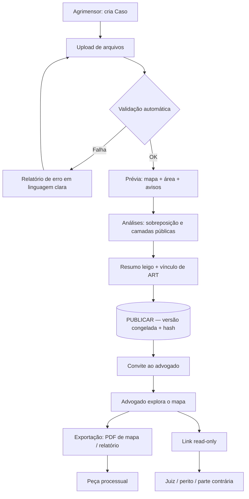
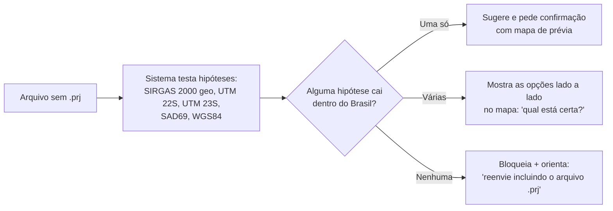
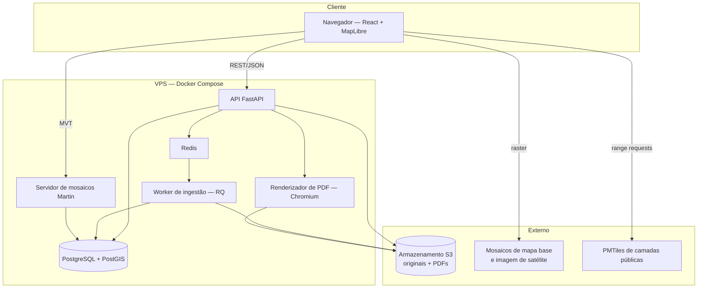
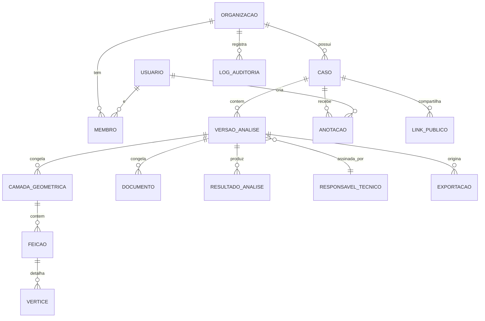

# Documento Base de Produto — Plataforma WebGIS Jurídico-Rural

**Versão:** 0.1 (discovery técnico + PRD)
**Data:** setembro/2026
**Status:** pré-desenvolvimento — base para Sprint 1

---

## 1. Sumário Executivo

Plataforma web onde um engenheiro agrimensor publica o resultado do seu trabalho técnico — perímetros georreferenciados, análises de sobreposição, memoriais, laudos e evidências fotográficas — como um **caso interativo**, e o advogado que contratou aquele trabalho abre esse caso em um mapa que ele consegue operar sem nunca ter ouvido falar em shapefile.

A cunha (*wedge*) não é "um QGIS na nuvem". É o momento específico em que o advogado precisa **escrever um número de área em uma petição e anexar um mapa que o juiz aceite**. Hoje ele recebe um PDF estático, não consegue verificar nada sozinho, e volta a ligar para o agrimensor a cada dúvida.

Quem paga: **o escritório de advocacia**, por caso publicado ou por assinatura mensal. O agrimensor publica de graça na v1 — ele é o canal de distribuição, não o cliente.

O produto **organiza e apresenta** prova técnica com rastreabilidade (hash do arquivo original, versão imutável, identificação do responsável técnico e ART). O produto **não certifica** nada: a responsabilidade técnica continua sendo do profissional habilitado.

---

## 2. Problema e Contexto Jurídico-Fundiário

O trabalho do agrimensor termina em um PDF de 40 páginas enviado por WhatsApp. Esse PDF contém a resposta certa, mas em um formato que o destinatário não consegue interrogar. O advogado não pode dar zoom, não pode medir, não pode ligar e desligar uma camada, não pode comparar a imagem de satélite de 2019 com a de 2024. Ele pode apenas ler e acreditar.

Isso produz três falhas concretas.

**Falha 1 — o advogado não consegue verificar, então não consegue argumentar.** Quando a parte contrária apresenta um laudo com número diferente, o advogado não tem meio próprio de entender *por que* os números divergem. Ele reenvia tudo ao agrimensor e espera. Sob prazo processual, isso custa a impugnação.

**Falha 2 — o agrimensor repete a mesma explicação para sempre.** Cada entrega gera uma sequência de ligações explicando o que é uma sobreposição, por que a área da matrícula difere da área medida, e o que significa a linha vermelha no mapa. Esse tempo não é faturado.

**Falha 3 — o trabalho perde autoria e rastreabilidade.** O PDF é encaminhado, recortado, colado em petição, e três meses depois ninguém sabe qual versão está no processo, nem se o polígono citado é o mesmo que o agrimensor entregou.

### Cenários realistas

**Cenário A — Ação demarcatória com sobreposição de matrículas.**
Dois vizinhos apresentam títulos que descrevem, em parte, a mesma faixa de terra. O agrimensor levanta os dois perímetros e calcula uma interseção. O advogado precisa de: o número de hectares sobrepostos, a representação visual da faixa, a comparação com os perímetros certificados no SIGEF (se houver), e um mapa exportável para instruir a inicial. Hoje ele recebe três PDFs e uma planilha.

**Cenário B — Contestação de laudo em desapropriação / servidão administrativa.**
A concessionária apresenta um traçado e uma área de servidão. O assistente técnico do proprietário mede novamente e chega a um valor maior. A diferença pode ser de método (área projetada vs. área geodésica), de datum, ou de erro real. O advogado precisa **mostrar ao juiz onde os dois traçados divergem** — algo que dois PDFs lado a lado não fazem.

**Cenário C — Sobreposição com APP, Reserva Legal ou área embargada.**
O imóvel tem CAR, e parte da área produtiva declarada cai sobre APP ou sobre um embargo. O advogado precisa entender a extensão exata do conflito antes de escolher a tese. Os dados existem publicamente (SICAR, IBAMA), mas em formato que ele não consegue abrir.

Não há, até onde apuramos, estatística pública consolidada sobre o volume de litígios rurais com componente georreferenciado no Brasil `[verificar]`. O dimensionamento de mercado da Fase 0 depende de entrevistas, não de dado secundário.

---

## 3. Personas, Jobs-to-be-Done e Cenários de Uso

| Persona | Job (o que ele contrata o produto para fazer) | Gatilho | Resultado esperado | Feature que atende |
|---|---|---|---|---|
| Agrimensor | Entregar o laudo sem precisar explicá-lo três vezes | Terminou o levantamento no QGIS/CAD | Cliente entende sozinho; profissional identificado na entrega | Ingestão + publicação de caso (RF-ING-001, RF-CAS-002) |
| Agrimensor | Provar que a versão citada no processo é a que ele produziu | Advogado citou um número que ele não reconhece | Histórico de versões com hash e data | Versionamento imutável (RF-DOC-004) |
| Agrimensor | Ganhar receita recorrente de um trabalho já entregue | Cliente pede "só uma olhada" meses depois | Acesso continuado ao caso, sem retrabalho | Caso ativo com validade (RF-CAS-004) |
| Advogado | Descobrir quantos hectares estão em disputa | Vai redigir a petição inicial | Número em hectares, com método declarado, copiável | Motor de sobreposição (RF-ANL-001) |
| Advogado | Mostrar ao juiz onde é a área | Vai protocolar peça ou levar à audiência | Mapa PDF com escala, norte, legenda, coordenadas | Exportação probatória (RF-EXP-001) |
| Advogado | Entender por que dois laudos divergem | Recebeu laudo da parte contrária | Comparação visual dos dois traçados | Cortina/swipe + carga do perímetro adverso (RF-GIS-005) |
| Advogado | Verificar se o imóvel tem conflito ambiental | Escolhendo a tese | Camadas CAR/APP/embargo sobre o perímetro | Camadas públicas pré-carregadas (RF-GIS-003) |
| Juiz / perito / parte contrária | Abrir o material sem instalar nada e sem criar conta | Recebeu link no processo | Mapa somente-leitura, com identificação do autor | Link público read-only (RF-CAS-005) |

Todo requisito neste documento declara a persona que serve. Requisito sem persona é escopo indevido.

---

## 4. Proposta de Valor e Diferenciação

**(a) Contra o PDF por e-mail.** O PDF vence em uma coisa importante: é universalmente aceito, funciona offline, e o juiz sabe o que fazer com ele. Por isso o produto **não substitui o PDF — ele o gera**. O ganho está no que acontece antes do PDF: o advogado explora, entende, escolhe o recorte e só então exporta. E o ganho está no depois: o link do caso continua vivo quando surgir a próxima dúvida.

**(b) Contra o QGIS puro.** O QGIS é gratuito e infinitamente mais poderoso. Ele perde por um motivo só: exige alfabetização em GIS. O advogado não vai aprender projeções para ganhar uma causa, e o agrimensor não vai dar suporte de software para o cliente. O produto troca poder por ausência de curva de aprendizado — e assume essa troca explicitamente.

**(c) Contra os portais públicos (SIGEF, SICAR, Acervo Fundiário).** Eles são a fonte da verdade e são gratuitos. Perdem em três pontos: exigem login gov.br nível prata/ouro para consulta interativa desde outubro de 2023 `[verificar]`, entregam dados brutos por município ou estado em ZIPs de shapefile atrás de captcha, e **não conversam entre si**. Ninguém no SIGEF cruza a parcela certificada com o CAR do vizinho e com o polígono do laudo particular. O produto faz esse cruzamento sobre um caso específico.

**(d) Contra plataformas de agro/geo existentes.** Existem plataformas maduras de inteligência territorial voltadas a crédito rural, compliance e originação agrícola. Elas vencem em cobertura de dados e em maturidade. Perdem porque o comprador delas é o banco, a trading ou a usina — o produto é desenhado para due diligence em escala, não para **um caso, um processo, uma tese**. Nenhuma delas trata o conceito de "versão publicada e imutável, assinada por um responsável técnico, referenciada em um processo judicial". Preços e funcionalidades específicas de concorrentes: `[verificar]` em Fase 0.

---

## 5. Fluxos Principais (end-to-end)

### 5.1 Fluxo mestre

1. O agrimensor cria um **Caso** (nome, comarca, número do processo se houver, partes).
2. Ele arrasta os arquivos do levantamento: pasta do shapefile completa, DXF, KML, GeoJSON, planilha SIGEF, PDFs de memorial e matrícula, fotos.
3. O sistema **detecta o sistema de coordenadas**, reprojeta para o padrão canônico, valida a topologia e calcula a área. Em caso de dúvida, pergunta — em português, sem jargão.
4. O agrimensor revisa a prévia: perímetro no mapa, área calculada, avisos de validação.
5. Ele roda as análises: sobreposição entre perímetros do caso, cruzamento com camadas públicas.
6. Ele escreve um **resumo em linguagem leiga** (campo obrigatório, máx. 800 caracteres) e vincula sua ART.
7. Ele **publica** a versão. A partir daqui a geometria é imutável.
8. Ele convida o advogado por e-mail.
9. O advogado abre o caso, explora o mapa, lê os documentos, mede, compara, anota.
10. Ele gera a **peça exportável**: mapa PDF com escala/norte/legenda/coordenadas, relatório de sobreposição, memorial.
11. Ele gera um **link somente-leitura** para juntar ao processo — sem conta, sem software, com validade configurável.

### 5.2 Diagrama

### 5.3 Fluxo de exceção — CRS não identificado

---

## 6. Escopo — MVP vs. Fora de Escopo

### 6.1 Dentro do MVP (v1)

- Contas de organização (escritório de advocacia / empresa de agrimensura) com usuários e papéis.
- Criação de Caso e convite de participantes.
- Ingestão de: SHP (bundle .shp/.dbf/.shx/.prj), KML/KMZ, GeoJSON, GPKG, DXF (apenas polilinhas fechadas), planilha SIGEF (ODS/CSV), PDF e imagens como anexos.
- Detecção e reprojeção de CRS com confirmação humana.
- Validação topológica e relatório de erros em linguagem clara.
- Cálculo de área em UTM SIRGAS 2000 da zona do imóvel, com método declarado.
- Detecção de sobreposição entre perímetros do caso.
- Visualizador de mapa com camadas públicas pré-ingeridas para os municípios atendidos.
- Ferramentas de mapa: medir, comparar/cortina, imagem por ano, anotar, fixar ponto de vista.
- Publicação de versão imutável com hash e ART.
- Exportação: mapa PDF (A4/A3, escala, norte, legenda, grade de coordenadas) e relatório de sobreposição.
- Link somente-leitura com expiração.
- Log de auditoria.

### 6.2 Fora de Escopo (v1) — obrigatório

1. **App nativo (iOS/Android).** O advogado trabalha no desktop ao redigir petição. Web responsiva cobre a consulta em audiência. Custo de duas plataformas nativas destrói o orçamento.
2. **Coleta em campo offline.** É produto de agrimensor, não de advogado. Ele já tem GPS geodésico e coletor. Não é o gargalo.
3. **Análise de documentos por IA (leitura de matrícula, extração de memorial).** Alto valor percebido, alta taxa de erro, e erro aqui vai para dentro de um processo judicial. Deterministicamente inviável de garantir na v1.
4. **Blockchain / notarização em cadeia.** Hash SHA-256 + carimbo de tempo do servidor + log de auditoria resolve o problema real (integridade e rastreabilidade). Blockchain adiciona zero valor probatório incremental e muito custo de explicação.
5. **Marketplace de serviços (advogado contrata agrimensor pela plataforma).** É um segundo produto, com problema próprio de confiança, pagamento e disputa. Diluiria o foco antes do primeiro cliente pagante.
6. **Integração automática com PJe / e-SAJ / Projudi.** Cada tribunal tem interface e regra diferente; muitos exigem certificado ICP-Brasil do próprio advogado. Na v1 o advogado baixa o PDF e faz o upload manualmente — que é o que ele já faz hoje.
7. **Edição de geometria no navegador.** Se o advogado puder mover um vértice, a cadeia de responsabilidade técnica se rompe. Correção geométrica é trabalho do agrimensor, no software dele, gerando nova versão.
8. **Ingestão automática do CAR nacional.** O SICAR não expõe API nem WMS aberto; o download é por município/estado, atrás de captcha, e a base nacional descompactada passa de 100 GB `[verificar]`. Na v1 ingerimos sob demanda apenas os municípios dos casos ativos.
9. **Assinatura digital ICP-Brasil dentro da plataforma.** Importante para o valor probatório, mas envolve integração com AC, custo por assinatura e responsabilidade jurídica. Fase 2. Na v1 o agrimensor assina fora e anexa o PDF assinado.
10. **Análise 3D, perfil de terreno, curvas de nível e cálculo de volume.** Relevante em perícia de terraplenagem e barragem, irrelevante para o litígio de limites que é a cunha escolhida.
11. **Faturamento, split de pagamento e emissão de nota entre as partes.** Na v1 a cobrança é feita fora da plataforma, por contrato direto.
12. **Multi-idioma.** O produto é jurídico-brasileiro. Não há usuário fora do pt-BR.

---

## 7. Requisitos Funcionais

Prioridade em MoSCoW: **Must** (v1 não existe sem), **Should** (v1 fica pior sem), **Could** (se sobrar tempo), **Won't** (v1 não terá).

### 7.1 Módulo — Ingestão & Validação de Dados (RF-ING)

> **RF-ING-001 — Upload de pacote de levantamento**
> *Persona:* Agrimensor
> *Descrição:* o usuário arrasta uma pasta ou múltiplos arquivos; o sistema identifica automaticamente os conjuntos que pertencem entre si (ex.: `lote01.shp` + `.dbf` + `.shx` + `.prj`) e trata cada conjunto como uma camada candidata.
> *Critério de aceite:* dado um diretório com 3 shapefiles completos e 2 PDFs, o sistema apresenta 3 camadas candidatas e 2 documentos, sem intervenção do usuário.
> *Prioridade:* Must

> **RF-ING-002 — Detecção e confirmação de sistema de coordenadas**
> *Persona:* Agrimensor
> *Descrição:* o sistema lê o CRS declarado no arquivo. Se ausente ou incoerente com a localização, testa hipóteses comuns no Brasil e apresenta prévias no mapa para o usuário escolher, em linguagem sem código EPSG.
> *Critério de aceite:* dado um `.shp` sem `.prj` cujas coordenadas são compatíveis com UTM 22S, o sistema apresenta a prévia posicionada corretamente e a legenda "Coordenadas UTM, fuso 22 Sul — confere?", com opção de corrigir.
> *Prioridade:* Must

> **RF-ING-003 — Validação topológica**
> *Persona:* Agrimensor
> *Descrição:* verifica polígono não fechado, auto-interseção, vértices duplicados, buracos não intencionais, geometria vazia e ordem de vértices; gera relatório com localização de cada problema no mapa.
> *Critério de aceite:* dado um polígono com uma auto-interseção, o sistema bloqueia a publicação, aponta o ponto exato no mapa e oferece a opção "corrigir automaticamente" com prévia do resultado antes/depois.
> *Prioridade:* Must

> **RF-ING-004 — Importação de planilha SIGEF**
> *Persona:* Agrimensor
> *Descrição:* lê a planilha ODS/CSV no modelo SIGEF e reconstrói o perímetro a partir dos vértices, preservando código de vértice, tipo, método de posicionamento e confrontantes.
> *Critério de aceite:* dada uma planilha com 120 vértices, o sistema gera o polígono fechado, exibe a tabela de vértices e a lista de confrontantes, e sinaliza divergência se o fechamento exceder a tolerância declarada.
> *Prioridade:* Should

> **RF-ING-005 — Limite e rejeição controlada de arquivos pesados**
> *Persona:* Agrimensor
> *Descrição:* arquivos acima do limite são rejeitados com mensagem explicando o motivo e sugerindo recorte da área de interesse.
> *Critério de aceite:* upload de 250 MB retorna, em até 5 s, mensagem clara indicando o limite de 200 MB e orientando o recorte — sem timeout nem erro genérico.
> *Prioridade:* Must

### 7.2 Módulo — Motor WebGIS (RF-GIS)

> **RF-GIS-001 — Renderização de perímetro em mapa interativo**
> *Persona:* Advogado, Agrimensor
> *Descrição:* exibe as geometrias do caso sobre mapa base, com controles de zoom, deslocamento e enquadramento automático na área do caso.
> *Critério de aceite:* perímetro de 5.000 vértices renderiza com primeira pintura em ≤ 2 s em conexão 4G típica (10 Mbps, 80 ms de latência).
> *Prioridade:* Must

> **RF-GIS-002 — Alternância de mapas base**
> *Persona:* Advogado
> *Descrição:* alterna entre mapa de ruas, satélite recente e relevo sombreado.
> *Critério de aceite:* troca de base ocorre em ≤ 300 ms sem recarregar as camadas do caso.
> *Prioridade:* Must

> **RF-GIS-003 — Camadas de contexto público**
> *Persona:* Advogado, Agrimensor
> *Descrição:* liga/desliga camadas de parcelas certificadas (SIGEF/SNCI), CAR, assentamentos, terras indígenas, unidades de conservação e limites municipais, restritas à área do caso.
> *Critério de aceite:* ao ligar "Imóveis certificados pelo INCRA", as parcelas dentro do enquadramento aparecem em ≤ 1,5 s, cada uma com data de referência da base visível ao clicar.
> *Prioridade:* Must

> **RF-GIS-004 — Medição de distância e área**
> *Persona:* Advogado
> *Descrição:* desenha uma linha ou polígono temporário e retorna comprimento em metros e área em hectares, com aviso de que é medição aproximada de apoio, não peça técnica.
> *Critério de aceite:* medição sobre um polígono de referência de 100,00 ha retorna 100,00 ha ± 0,05 ha e exibe o aviso.
> *Prioridade:* Should

> **RF-GIS-005 — Comparação por cortina (swipe)**
> *Persona:* Advogado
> *Descrição:* divide o mapa com uma barra arrastável comparando duas configurações — dois anos de imagem, ou traçado do laudo A contra traçado do laudo B.
> *Critério de aceite:* com dois perímetros carregados, arrastar a barra alterna a exibição sem piscar e mantém posição e zoom sincronizados.
> *Prioridade:* Should

> **RF-GIS-006 — Imagem de satélite por ano**
> *Persona:* Advogado
> *Descrição:* seletor de ano que troca o mosaico de imagem, para demonstrar ocupação, supressão de vegetação ou benfeitorias ao longo do tempo.
> *Critério de aceite:* seletor cobre no mínimo 5 anos distintos e cada troca carrega em ≤ 3 s; cada imagem exibe fonte e data.
> *Prioridade:* Could

> **RF-GIS-007 — Anotações do advogado**
> *Persona:* Advogado
> *Descrição:* adiciona setas, textos e marcadores sobre o mapa, salvos na sua conta, **visualmente distintos** do material técnico e nunca incorporados à versão publicada.
> *Critério de aceite:* anotação criada pelo advogado aparece em estilo tracejado com rótulo "anotação do usuário" e não altera o hash da versão publicada.
> *Prioridade:* Should

### 7.3 Módulo — Análises Geoespaciais (RF-ANL)

> **RF-ANL-001 — Detecção de sobreposição entre perímetros**
> *Persona:* Advogado, Agrimensor
> *Descrição:* ao carregar dois ou mais perímetros no mesmo caso, o sistema calcula a interseção geométrica e apresenta área sobreposta em hectares e percentual sobre cada polígono.
> *Critério de aceite:* dados dois polígonos com interseção conhecida de 12,4 ha, o sistema retorna 12,4 ha ± 0,01 ha e destaca a área em vermelho no mapa.
> *Prioridade:* Must

> **RF-ANL-002 — Declaração do método de cálculo de área**
> *Persona:* Advogado, Agrimensor
> *Descrição:* toda área exibida vem acompanhada do método usado (projeção UTM SIRGAS 2000, fuso X) e de aviso quando o polígono cruza dois fusos.
> *Critério de aceite:* área exibida traz o rótulo "calculada em UTM SIRGAS 2000, fuso 22S" e, se o polígono cruzar fusos, exibe alerta e usa cálculo geodésico com o método indicado.
> *Prioridade:* Must

> **RF-ANL-003 — Cruzamento com camadas públicas**
> *Persona:* Advogado, Agrimensor
> *Descrição:* calcula a área de interseção do perímetro do caso com cada camada pública ligada, listando resultado por camada.
> *Critério de aceite:* para um perímetro que intersecta uma APP declarada no CAR, o sistema retorna a área em hectares, o percentual do imóvel, e a data de referência da base do CAR usada.
> *Prioridade:* Should

> **RF-ANL-004 — Comparação entre área medida e área da matrícula**
> *Persona:* Advogado
> *Descrição:* campo para informar a área constante na matrícula; o sistema apresenta a diferença absoluta e percentual, sem emitir juízo sobre a causa.
> *Critério de aceite:* com matrícula de 500,0000 ha e medição de 512,3400 ha, retorna "+12,3400 ha (+2,47%)" e um texto neutro explicando que a divergência pode ter várias causas.
> *Prioridade:* Should

### 7.4 Módulo — Documentos & Evidências (RF-DOC)

> **RF-DOC-001 — Repositório de documentos do caso**
> *Persona:* Advogado, Agrimensor
> *Descrição:* armazena PDFs (memorial, matrícula, ART, laudo) e imagens, com visualizador embutido e busca por nome e tipo.
> *Critério de aceite:* PDF de 20 MB abre no visualizador embutido em ≤ 4 s, sem download obrigatório.
> *Prioridade:* Must

> **RF-DOC-002 — Fotografia georreferenciada**
> *Persona:* Agrimensor, Advogado
> *Descrição:* fotos com EXIF de GPS aparecem como pontos clicáveis no mapa; fotos sem coordenada podem ser posicionadas manualmente pelo agrimensor, com marcação explícita de "posição informada pelo profissional".
> *Critério de aceite:* foto com EXIF válido aparece na posição correta ± 10 m; foto sem EXIF exige posicionamento manual e recebe o rótulo distintivo.
> *Prioridade:* Should

> **RF-DOC-003 — Resumo em linguagem leiga**
> *Persona:* Advogado
> *Descrição:* campo obrigatório na publicação, exibido como primeira coisa que o advogado vê ao abrir o caso.
> *Critério de aceite:* publicação é bloqueada se o campo estiver vazio ou com menos de 100 caracteres.
> *Prioridade:* Must

> **RF-DOC-004 — Versionamento imutável da análise publicada**
> *Persona:* Agrimensor, Advogado, Juiz
> *Descrição:* ao publicar, geometrias, documentos e resultados são congelados; correções geram nova versão, e versões anteriores permanecem acessíveis e citáveis.
> *Critério de aceite:* após publicação, qualquer tentativa de alterar geometria da v1 é rejeitada; ao publicar a v2, o link da v1 continua funcionando e exibe aviso "existe versão mais recente (v2)".
> *Prioridade:* Must

> **RF-DOC-005 — Hash e procedência dos arquivos originais**
> *Persona:* Agrimensor, Juiz
> *Descrição:* calcula SHA-256 de cada arquivo enviado e o exibe na ficha técnica da versão, junto de data/hora de recebimento e usuário responsável.
> *Critério de aceite:* a ficha técnica lista nome do arquivo, tamanho, SHA-256 completo e carimbo de tempo em ISO 8601 com fuso.
> *Prioridade:* Must

### 7.5 Módulo — Casos/Projetos & Colaboração (RF-CAS)

> **RF-CAS-001 — Criação e identificação do caso**
> *Persona:* Agrimensor, Advogado
> *Descrição:* caso com nome, comarca, número do processo (opcional), tipo de ação e partes.
> *Critério de aceite:* caso pode ser criado sem número de processo (fase pré-judicial) e o número pode ser adicionado depois sem quebrar links existentes.
> *Prioridade:* Must

> **RF-CAS-002 — Publicação e convite**
> *Persona:* Agrimensor
> *Descrição:* publica a versão e envia convite por e-mail ao advogado, com criação de conta em um clique.
> *Critério de aceite:* advogado convidado acessa o caso em no máximo 3 cliques a partir do e-mail, sem precisar preencher formulário longo.
> *Prioridade:* Must

> **RF-CAS-003 — Perguntas do advogado ao agrimensor, ancoradas no mapa**
> *Persona:* Advogado, Agrimensor
> *Descrição:* o advogado marca um ponto ou área e escreve uma pergunta; o agrimensor recebe notificação com o contexto geográfico já carregado.
> *Critério de aceite:* ao abrir a notificação, o agrimensor cai no mapa já enquadrado no local da pergunta.
> *Prioridade:* Should

> **RF-CAS-004 — Validade e arquivamento do caso**
> *Persona:* Agrimensor, Advogado
> *Descrição:* casos têm status ativo/arquivado; arquivados ficam somente-leitura e saem da contagem do plano.
> *Critério de aceite:* caso arquivado continua acessível e exportável, mas não aceita novas versões.
> *Prioridade:* Should

> **RF-CAS-005 — Link somente-leitura sem conta**
> *Persona:* Juiz, perito, parte contrária
> *Descrição:* gera URL com token, validade configurável e senha opcional, que abre o caso em modo leitura, sem exportação por padrão.
> *Critério de aceite:* link aberto em navegador anônimo mostra o mapa e os documentos, não mostra o painel de administração, e registra cada acesso no log de auditoria.
> *Prioridade:* Must

### 7.6 Módulo — Exportação & Peças (RF-EXP)

> **RF-EXP-001 — Mapa em PDF pronto para juntada**
> *Persona:* Advogado
> *Descrição:* exporta o enquadramento atual como PDF A4 ou A3 contendo escala gráfica e numérica, seta de norte, legenda, grade de coordenadas, data de geração, identificação do responsável técnico e número da ART, versão do caso e código de verificação.
> *Critério de aceite:* PDF gerado em ≤ 20 s, com 300 dpi na área do mapa, escala correta verificável com régua sobre a impressão em tamanho real.
> *Prioridade:* Must

> **RF-EXP-002 — Relatório de sobreposição**
> *Persona:* Advogado
> *Descrição:* documento com a lista de interseções, áreas em hectares, percentuais, método de cálculo, mapa da faixa sobreposta e tabela de vértices da interseção.
> *Critério de aceite:* relatório de dois perímetros com 12,4 ha de interseção apresenta o mesmo valor exibido no mapa, sem divergência de arredondamento.
> *Prioridade:* Must

> **RF-EXP-003 — Exportação de dados brutos**
> *Persona:* Agrimensor, perito judicial
> *Descrição:* baixa as geometrias em GeoJSON, KML e SHP, no CRS original e no canônico.
> *Critério de aceite:* arquivo exportado reaberto no QGIS reproduz a geometria com diferença posicional < 1 cm.
> *Prioridade:* Should

> **RF-EXP-004 — Código de verificação da exportação**
> *Persona:* Juiz, parte contrária
> *Descrição:* todo PDF exportado traz um código e uma URL curta que abre uma página pública confirmando: caso, versão, data de geração, responsável técnico e hash — sem expor o conteúdo do caso.
> *Critério de aceite:* a página de verificação carrega sem login e não revela geometrias, documentos nem nomes das partes.
> *Prioridade:* Should

### 7.7 Módulo — Contas, Permissões e Auditoria (RF-ACC)

> **RF-ACC-001 — Organizações e papéis**
> *Persona:* Todos
> *Descrição:* papéis de Administrador da organização, Agrimensor publicador, Advogado consumidor e Convidado leitura.
> *Critério de aceite:* usuário com papel Advogado não consegue publicar versão nem editar geometria, testado por chamada direta à API.
> *Prioridade:* Must

> **RF-ACC-002 — Isolamento entre organizações**
> *Persona:* Advogado, Agrimensor
> *Descrição:* nenhum dado de um escritório é acessível a outro; o isolamento é aplicado na camada de dados, não apenas na interface.
> *Critério de aceite:* requisição autenticada da organização A para um recurso da organização B retorna 404, não 403 — sem confirmar a existência do recurso.
> *Prioridade:* Must

> **RF-ACC-003 — Log de auditoria**
> *Persona:* Agrimensor, Advogado, Administrador
> *Descrição:* registra criação, publicação, visualização, exportação, geração e acesso a link público, com usuário, data/hora e IP.
> *Critério de aceite:* o log é apenas-inserção, exportável em CSV, e registra acessos anônimos via link público com identificação do token.
> *Prioridade:* Must

> **RF-ACC-004 — Caso sob segredo de justiça**
> *Persona:* Advogado
> *Descrição:* marcação que desabilita links públicos, força senha em todo compartilhamento e destaca visualmente o caso.
> *Critério de aceite:* com a marcação ativa, o botão de gerar link público fica indisponível e a tentativa via API é rejeitada.
> *Prioridade:* Should

---

## 8. Requisitos Não Funcionais

**Desempenho**
- Primeira renderização de um perímetro de 5.000 vértices: ≤ 2 s em 4G (10 Mbps / 80 ms).
- Interação de mapa (pan/zoom): ≥ 30 fps em notebook de escritório típico (4 núcleos, gráficos integrados).
- Ativar/desativar camada: ≤ 300 ms.
- Cálculo de sobreposição entre dois polígonos de até 10.000 vértices: ≤ 5 s.
- Processamento de ingestão de um pacote de 50 MB: ≤ 60 s do upload à prévia.
- Geração de PDF de mapa: ≤ 20 s.

**Limites**
- 200 MB por pacote de upload; 50 MB por arquivo individual.
- 50.000 vértices por geometria; acima disso, simplificação automática **apenas para exibição**, nunca para cálculo, com aviso visível.
- 200 casos ativos por organização na v1.

**Disponibilidade e continuidade**
- Alvo de 99,0% mensal. **Sem SLA contratual na v1** — declarado no contrato.
- Backup: dump diário do banco + arquivamento contínuo de WAL; arquivos originais em armazenamento de objetos com versionamento. RPO 24 h, RTO 4 h.
- Restauração testada trimestralmente.

**LGPD e retenção**
- Dados de casos retidos enquanto a assinatura estiver ativa e por mais 90 dias após o cancelamento; depois, exclusão com registro.
- Exportação integral dos dados da organização a qualquer momento (portabilidade).
- Logs de auditoria retidos por 5 anos.

**Acessibilidade e ambiente**
- Contraste WCAG 2.1 AA na interface fora do mapa; corpo de texto ≥ 16 px; navegação por teclado nos painéis de documento e formulários. O mapa em si atende parcialmente — limitação declarada.
- Navegadores: Chrome, Edge e Firefox nas duas últimas versões; Safari 16+.
- **Conexão ruim (interior):** mosaicos com cache agressivo, geometrias entregues simplificadas por nível de zoom, e geração de PDF no servidor (cliente fraco não impede exportação). O "pacote do caso" — PDF único com mapa, resumo e documentos — permite levar tudo para uma audiência sem internet.

---

## 9. Arquitetura Técnica

### 9.1 Escolhas e alternativas rejeitadas

| Camada | Escolha | Justificativa | Alternativa rejeitada e porquê |
|---|---|---|---|
| Biblioteca de mapa | MapLibre GL JS | Vetorial, WebGL, gratuita, sem lock-in de fornecedor de mosaicos; já é ferramenta conhecida do time | Leaflet (raster, sem estilo dinâmico, sofre com perímetros densos); Mapbox GL JS (licença e cobrança por carregamento de mapa); OpenLayers (mais verboso, curva maior para pouca vantagem aqui) |
| Frontend | React + TypeScript (Next.js) | Ecossistema de componentes maduro; renderização no servidor útil para as páginas públicas de verificação | SvelteKit (menor ecossistema geoespacial); app puramente estático (não atende autenticação e casos privados) |
| Backend | Python + FastAPI | O geoprocessamento sério em Python (GDAL, Shapely, GeoPandas, pyproj) é insubstituível; é a linguagem principal do time | Node.js (ferramental geoespacial mais fraco, exigiria processos Python auxiliares de qualquer forma); Django (mais peso do que a API precisa) |
| Banco | PostgreSQL + PostGIS | Padrão de fato; faz interseção, reprojeção, validação e servidor de mosaicos vetoriais dentro do próprio banco | MongoDB geoespacial (sem operações topológicas confiáveis); SpatiaLite (não serve multiusuário) |
| Mosaicos vetoriais | Martin (ou pg_tileserv) lendo direto do PostGIS + PMTiles estático para camadas públicas grandes | Zero pipeline extra para dados do caso; PMTiles remove a necessidade de servidor de mosaicos para bases públicas | GeoServer (JVM, operação pesada demais para uma pessoa); gerar mosaicos sob demanda na aplicação (latência imprevisível) |
| Armazenamento de arquivos | S3 compatível com versionamento | Originais imutáveis, PDFs gerados, fotos | Disco local no servidor (sem durabilidade, complica o backup) |
| Fila de processamento | Redis + RQ | Ingestão pesada fora do ciclo de requisição; simples de operar | Celery + RabbitMQ (mais peças para o mesmo resultado nesta escala); processamento síncrono (estoura timeout em pacote grande) |
| Geração de PDF | Playwright/Chromium sem interface, renderizando um gabarito HTML com o mapa | Controle total de escala, dpi e diagramação; reaproveita o mesmo estilo de mapa da tela | jsPDF no cliente (sem controle de dpi nem de escala impressa); LaTeX (mapa é o problema, não o texto) |
| Autenticação | Biblioteca de sessão própria sobre o banco, com e-mail + senha e link mágico para convidados | Sem dependência externa em dado sensível; convidado precisa de fluxo sem senha | Auth0/Clerk (custo por usuário ativo e dado de identidade fora do Brasil); Keycloak (operação desproporcional) |
| Hospedagem | VPS único com Docker Compose, em provedor com região no Brasil | Latência, LGPD e custo previsível; um só servidor cabe no volume da v1 | Kubernetes (over-engineering flagrante nesta fase); plataforma serverless (mal casada com GDAL e processos longos) |

### 9.2 Diagrama de arquitetura

### 9.3 Responsabilidade dos componentes

| Componente | Responsabilidade | Não é responsável por |
|---|---|---|
| API FastAPI | Autenticação, autorização, CRUD de casos, orquestração de publicação, auditoria | Geoprocessamento pesado, renderização |
| Worker de ingestão | Leitura de formatos, detecção de CRS, reprojeção, validação topológica, cálculo de área, cruzamentos | Decidir por conta própria em caso ambíguo — sempre devolve a decisão ao agrimensor |
| PostGIS | Verdade geométrica, interseções, versões congeladas, geração de MVT | Armazenar arquivos binários originais |
| Martin | Servir mosaicos vetoriais das geometrias do caso | Autorização (é aplicada por token repassado pela API) |
| S3 | Durabilidade e imutabilidade de originais e PDFs | Servir conteúdo diretamente ao público (URLs assinadas com expiração) |
| Renderizador de PDF | Diagramar mapa + metadados em escala correta | Recalcular áreas — recebe valores prontos do PostGIS |

---

## 10. Modelo de Dados

### 10.1 Estratégia de geometria e CRS

- **Armazenamento canônico:** EPSG:4674 (SIRGAS 2000 geográfico). É o sistema geodésico oficial brasileiro e o referencial das bases do INCRA.
- **Exibição:** reprojeção para EPSG:3857 (Web Mercator) só na geração do mosaico vetorial.
- **Cálculo de área com valor jurídico:** projeção na zona UTM SIRGAS 2000 correspondente ao imóvel (ex.: EPSG:31982 para o fuso 22S), que é o mesmo referencial das peças do SIGEF. **Área nunca é calculada em Web Mercator** — a distorção nas latitudes brasileiras produziria erro grosseiro.
- Polígono que cruza dois fusos: cálculo geodésico sobre o elipsoide, com o método declarado no resultado e no relatório.
- O CRS original de cada arquivo é preservado como metadado, junto do parâmetro de transformação aplicado.

### 10.2 Entidades

- **Organizacao** — escritório de advocacia ou empresa de agrimensura; raiz do isolamento de dados.
- **Usuario / Membro** — pessoa e seu papel dentro de uma organização.
- **ResponsavelTecnico** — profissional habilitado: nome, CREA/CFT, e ART vinculada.
- **Caso** — nome, comarca, número do processo, tipo de ação, segredo de justiça, status.
- **VersaoAnalise** — a unidade imutável. Número, data de publicação, autor, resumo leigo, ART, hash do conjunto.
- **CamadaGeometrica** — pertence a uma versão; tipo (perímetro do laudo, perímetro adverso, servidão, benfeitoria), CRS original, geometria canônica.
- **Feicao** — geometria individual dentro da camada, com atributos e área calculada.
- **Vertice** — quando vindo de planilha SIGEF: código, tipo, método, precisão.
- **Documento** — arquivo original ou anexo; nome, tipo MIME, tamanho, SHA-256, chave no S3.
- **ResultadoAnalise** — sobreposição ou cruzamento: entradas, geometria da interseção, área, método, data.
- **Anotacao** — do usuário consumidor; nunca entra na versão publicada.
- **Exportacao** — PDF gerado: versão de origem, tipo, hash, código de verificação, quem gerou.
- **LinkPublico** — token, expiração, senha opcional, escopo.
- **LogAuditoria** — apenas-inserção.

### 10.3 Diagrama ER

### 10.4 Imutabilidade

A publicação copia geometrias, documentos e resultados para linhas vinculadas à `VersaoAnalise` e marca a versão como fechada. A aplicação recusa qualquer escrita nessas linhas; no banco, uma *trigger* de bloqueio faz o mesmo, para que um erro de código não consiga violar a garantia. Correção = nova versão. Versão anterior nunca é apagada, porque ela pode já estar citada em uma petição protocolada.

---

## 11. Pipeline de Ingestão

**Formatos aceitos na v1:** SHP (conjunto completo), GeoJSON, KML/KMZ, GPKG, DXF (somente polilinhas fechadas — blocos, textos e camadas de anotação são ignorados com aviso), planilha SIGEF em ODS/CSV, PDF e imagens como anexos. PDF de memorial é armazenado como documento, **não** interpretado automaticamente.

**Etapas**

1. **Recepção.** Arquivo vai direto para o S3; calcula-se SHA-256; a resposta é imediata e o processamento entra na fila.
2. **Agrupamento.** Identificação dos conjuntos que formam uma camada.
3. **Leitura.** GDAL/OGR extrai geometrias e atributos. Falha aqui gera erro nomeado ("o arquivo .dbf não corresponde ao .shp"), nunca *stack trace*.
4. **Determinação de CRS.** Se há `.prj` válido, usa. Se não, testa hipóteses (SIRGAS 2000 geográfico, WGS 84, UTM 18S–25S em SIRGAS 2000 e SAD 69, Córrego Alegre) e verifica qual coloca a geometria dentro do território nacional e próxima à comarca do caso. Resultado sempre confirmado por um humano.
5. **Reprojeção.** Para EPSG:4674, registrando o caminho de transformação. Transformações entre SAD 69 e SIRGAS 2000 usam a grade oficial quando disponível `[verificar disponibilidade da grade do IBGE em PROJ]`; caso contrário, transformação por parâmetros, com o método registrado no metadado — porque a diferença chega à ordem de dezenas de metros e isso importa em juízo.
6. **Validação topológica.** `ST_IsValid` + verificações próprias (fechamento, área nula, vértices coincidentes, orientação). Erros que impedem cálculo confiável bloqueiam a publicação; os demais viram avisos.
7. **Cálculo.** Área em UTM SIRGAS 2000 do fuso, perímetro, quantidade de vértices, envelope.
8. **Simplificação para exibição.** Versão simplificada por nível de zoom, armazenada em coluna separada e **nunca** usada em cálculo.
9. **Prévia.** O agrimensor vê mapa, área, avisos, e a lista do que foi ignorado.

**O que o agrimensor vê em caso de falha:** uma tela com o nome do arquivo, o problema em uma frase, a localização do problema no mapa quando aplicável, e a ação sugerida. Nunca "Erro 500". Nunca "Invalid geometry: self-intersection at POINT(...)" sozinho.

---

## 12. Módulo WebGIS — Especificação de Interface

### 12.1 Mapas base

Ruas, satélite recente, satélite histórico por ano, relevo sombreado. Fornecedor comercial de mosaicos (MapTiler ou equivalente) com cota gratuita na Fase 0 e plano pago ao entrar em produção `[verificar preços atuais]`.

### 12.2 Catálogo de camadas

| Camada | Fonte | Tipo | Atualização | Licença | Fase |
|---|---|---|---|---|---|
| Parcelas certificadas SIGEF/SNCI | Acervo Fundiário INCRA — download de shapefile por UF e WMS/WFS | Vetor | Quinzenal, conforme o portal `[verificar]` | Dados abertos do Incra `[verificar termos]` | 1 |
| Assentamentos INCRA | Acervo Fundiário INCRA | Vetor | Irregular | Dados abertos `[verificar]` | 1 |
| Territórios quilombolas | Acervo Fundiário INCRA | Vetor | Irregular | Dados abertos `[verificar]` | 2 |
| Imóveis e APP/RL do CAR | SICAR — download por município/estado, com captcha; **sem API pública** | Vetor | Sob demanda, por município do caso | `[verificar termos de uso]` | 1 (restrito) |
| Malha municipal e estadual | IBGE | Vetor | Anual | Dados abertos IBGE | 1 |
| Terras indígenas | FUNAI | Vetor | Irregular | `[verificar]` | 2 |
| Unidades de conservação | MMA/ICMBio | Vetor | Irregular | `[verificar]` | 2 |
| Embargos ambientais | IBAMA | Vetor | Irregular `[verificar disponibilidade em formato geoespacial]` | `[verificar]` | 2 |
| Cobertura e uso da terra | MapBiomas — serviço WMS de mosaicos, coleção anual | Raster | Anual | `[verificar termos para uso comercial]` | 2 |
| Desmatamento DETER/PRODES | INPE — WMS/WFS em data.inpe.br | Vetor | DETER quase diário; PRODES anual | `[verificar]` | 3 |
| Hidrografia | ANA / IBGE | Vetor | Irregular | `[verificar]` | 3 |

**Restrição operacional consequente:** como o SICAR não expõe API nem WMS aberto e a base nacional é grande demais para ingerir de forma preventiva, a v1 ingere CAR **por município, sob demanda**, quando um caso é criado naquele município. O primeiro caso de um município novo leva mais tempo para ficar completo; isso é comunicado ao agrimensor, não escondido.

### 12.3 Barra de ferramentas para quem não é do GIS

Sete botões, com rótulo escrito, não apenas ícone: **Medir**, **Comparar**, **Ver por ano**, **Anotar**, **Salvar esta vista**, **Camadas**, **Imprimir/Exportar**.

### 12.4 O princípio "GIS sem jargão"

Nenhum texto visível ao advogado contém código EPSG, "shapefile", "datum", "buffer", "geometria" ou "camada raster". O termo técnico pode existir — sempre atrás de um link "detalhes técnicos", para o perito e o agrimensor.

| O que NÃO escrever | O que escrever |
|---|---|
| "Reprojetando para EPSG:31982 (SIRGAS 2000 / UTM 22S)" | "Ajustando ao padrão oficial brasileiro de coordenadas (automático)" |
| "Faça upload do shapefile (.shp, .dbf, .shx, .prj)" | "Envie os arquivos do levantamento — pode arrastar a pasta inteira" |
| "Buffer de 50 m aplicado ao eixo" | "Faixa de 50 metros para cada lado" |
| "Área: 512.3400 ha (EPSG:31982)" | "Área: 512,3400 ha — calculada no mesmo padrão usado pelo INCRA · ver detalhes" |
| "Geometria inválida: self-intersection" | "O contorno se cruza em um ponto. Marcamos no mapa onde." |

---

## 13. Saídas Probatórias

**Artefatos exportáveis**

1. **Mapa em PDF** — A4 ou A3, escala gráfica e numérica, seta de norte, legenda, grade de coordenadas em SIRGAS 2000, data e hora de geração, nome e registro do responsável técnico, número da ART, identificação do caso e da versão, código de verificação.
2. **Relatório de sobreposição** — áreas, percentuais, método de cálculo, mapa da interseção, tabela de vértices.
3. **Memorial descritivo** — reprodução do documento fornecido pelo agrimensor; a plataforma **não gera memorial próprio** na v1.
4. **Pacote do caso** — PDF único reunindo resumo, mapa principal e documentos, para uso em audiência sem internet.
5. **Link somente-leitura** — com validade, senha opcional e registro de acesso.

**Integridade.** Cada exportação recebe SHA-256 próprio, carimbo de tempo do servidor em ISO 8601 com fuso, identificação do usuário que gerou, e um código verificável em página pública que confirma origem sem revelar conteúdo.

**O que a plataforma NÃO certifica — declarado no rodapé de todo PDF exportado:**

- Não certifica o imóvel. Certificação de imóvel rural é ato do INCRA, via SIGEF.
- Não substitui a ART nem a assinatura do profissional habilitado. A responsabilidade técnica pelo levantamento e pelos cálculos é do profissional identificado.
- Não atesta domínio, posse nem cadeia dominial. Isso é matéria de registro imobiliário e de decisão judicial.
- Não valida a exatidão das bases públicas de terceiros, apenas informa a fonte e a data de referência de cada uma.
- Não é assinatura digital com fé pública. Na v1, integridade é rastreabilidade — não é ICP-Brasil.

Essa distinção — **organizar e apresentar prova técnica** versus **certificar** — precisa aparecer no material de venda com a mesma clareza com que aparece aqui. Prometer valor probatório que o produto não entrega é o risco jurídico mais caro do negócio.

---

## 14. Segurança, LGPD e Sigilo Profissional

### 14.1 Matriz de permissões

| Ação | Admin org. | Agrimensor publicador | Advogado consumidor | Convidado (link) |
|---|---|---|---|---|
| Criar caso | ✔ | ✔ | ✔ | ✘ |
| Enviar arquivos | ✔ | ✔ | ✘ | ✘ |
| Publicar versão | ✔ | ✔ | ✘ | ✘ |
| Ver mapa e documentos | ✔ | ✔ | ✔ | ✔ |
| Medir e anotar | ✔ | ✔ | ✔ | ✘ |
| Exportar PDF | ✔ | ✔ | ✔ | conforme configuração |
| Gerar link público | ✔ | ✔ | ✔ | ✘ |
| Ver log de auditoria | ✔ | próprio | próprio | ✘ |
| Gerir usuários e cobrança | ✔ | ✘ | ✘ | ✘ |

### 14.2 Dados pessoais tratados

Nomes e e-mails dos usuários; nomes das partes e confrontantes; CPF/CNPJ quando constante em documentos anexados; localização de imóveis; endereços IP em log de auditoria.

**Bases legais:** execução de contrato para os dados dos usuários; e, para os dados de terceiros que aparecem em documentos do caso, o exercício regular de direitos em processo judicial, administrativo ou arbitral, previsto na LGPD (Lei 13.709/2018, art. 7º) `[verificar redação e inciso com assessoria jurídica]`.

**Ponto sensível:** o escritório é o controlador dos dados do caso; a plataforma é operadora. Isso precisa estar em contrato, com cláusula de tratamento de dados. Não é detalhe de rodapé — define quem responde por um vazamento.

### 14.3 Controles

Isolamento por organização aplicado na consulta ao banco (segurança em nível de linha no PostgreSQL, não apenas filtro na aplicação). Criptografia em trânsito (TLS 1.2+) e em repouso no armazenamento de objetos. URLs de arquivo sempre assinadas e de curta duração. Casos sob segredo de justiça com links públicos desabilitados. Log apenas-inserção. Segundo fator de autenticação: Fase 2.

---

## 15. Modelo de Negócio

**Quem paga:** o escritório de advocacia. O agrimensor publica gratuitamente na v1 — ele é o canal, e cobrar dele mataria a oferta antes de existir demanda.

**Hipótese de preços (a validar em Fase 0):**

| Plano | Preço/mês (BRL) | Inclui | Alvo |
|---|---|---|---|
| Caso avulso | R$ 390 por caso, acesso de 12 meses | 1 caso, até 3 usuários, exportações ilimitadas | Escritório testando |
| Escritório | R$ 690/mês | Até 10 casos ativos, 5 usuários, links ilimitados | Banca especializada em agrário |
| Escritório+ | R$ 1.490/mês | Até 40 casos ativos, 15 usuários, prioridade de ingestão | Banca média/grande |
| Agrimensor | Gratuito na v1; hipótese futura de R$ 149/mês para portfólio e marca própria | Publicação ilimitada | Canal |

**Premissas de economia unitária (todas a validar):** custo marginal de infraestrutura por caso ativo entre R$ 8 e R$ 25/mês, dominado por armazenamento e mosaicos comerciais; um servidor único suporta a carga da v1; custo de aquisição próximo de zero enquanto o canal for o agrimensor parceiro. Margem bruta alvo acima de 80% — **valor hipotético até haver dez casos reais medidos**.

**Estratégia de partida do mercado de dois lados.** O lado da oferta é semeado primeiro, e concretamente: o agrimensor parceiro já existe e já entrega laudos hoje. A pergunta "por que um agrimensor publicaria antes de existir advogado?" tem resposta específica — **ele não publica para um mercado, publica para o cliente que já é dele**. Cada caso migrado traz junto o advogado que contratou aquele caso. O crescimento é por replicação de dupla agrimensor-advogado, não por marketplace.

Consequência de produto: a v1 não precisa de busca, descoberta, perfil público nem catálogo de profissionais. Precisa de convite por e-mail funcionando bem.

---

## 16. Riscos

| Risco | Categoria | Impacto | Prob. | Mitigação | Sinal de alerta precoce |
|---|---|---|---|---|---|
| Erro de cálculo de área citado em petição gera prejuízo ao cliente | Jurídico | Crítico | Média | Cálculo sempre em UTM SIRGAS 2000 com método declarado; conjunto de testes com polígonos de área conhecida rodando a cada implantação; contrato limitando responsabilidade; a responsabilidade técnica permanece do profissional | Divergência entre valor da tela e valor do PDF em qualquer caso |
| Advogado interpreta o produto como certificação oficial | Jurídico/Mercado | Alto | **Alta** | Aviso em todo PDF e na tela do caso; texto de venda revisado; treinamento do agrimensor sobre como apresentar | Advogado usar a palavra "certificado" ao falar da plataforma |
| INCRA/SICAR muda portal, exige login ou derruba o download | Técnico | Alto | Alta | Cópia local versionada de cada base ingerida, com data de referência; nunca depender de chamada ao vivo em tempo de consulta | Falha em duas atualizações consecutivas da base |
| Shapefile de 400 MB ou geometria de 200 mil vértices trava a ingestão | Técnico | Médio | Alta | Limite explícito, processamento em fila, simplificação só para exibição, mensagem orientando recorte | Fila com tarefa acima de 5 minutos |
| CRS errado posiciona o imóvel a quilômetros do lugar certo | Técnico | Crítico | Média | Confirmação humana obrigatória com prévia no mapa; verificação de coerência com a comarca do caso | Perímetro fora do estado do caso |
| Transformação SAD 69 → SIRGAS 2000 sem grade produz deslocamento de dezenas de metros | Técnico | Alto | Média | Registrar o método usado em cada camada; alertar quando for transformação por parâmetros; incluir a advertência no relatório | Divergência entre laudo antigo e novo na mesma gleba |
| Vazamento de caso sob segredo de justiça | Segurança/Jurídico | Crítico | Baixa | Segurança em nível de linha, links desabilitados nesses casos, URLs assinadas de curta duração, log de auditoria | Acesso anônimo a caso marcado como sigiloso |
| Agrimensor parceiro sai do projeto | Mercado | Crítico | Média | Recrutar um segundo agrimensor até a semana 8; documentar o processo de ingestão para não depender do conhecimento dele | Queda na frequência de publicação |
| Advogado abre uma vez e não volta | Mercado | Alto | **Alta** | Resumo leigo obrigatório na abertura; medir retorno em 14 dias como métrica central | Menos de 2 sessões por caso no primeiro mês |
| Custo de mosaicos comerciais cresce mais rápido que a receita | Financeiro | Médio | Média | Cache agressivo; alerta de cota; migrar para mosaicos próprios se o custo passar de 15% da receita | Custo por caso ativo acima de R$ 40/mês |
| Escritório não paga por ferramenta — repassa custo ao cliente e trava | Mercado | Alto | Média | Testar cobrança por caso, repassável como despesa processual, além da assinatura | Objeção de preço em 3 das 5 primeiras entrevistas |
| Escopo cresce durante o desenvolvimento e o MVP não sai | Execução | Crítico | **Alta** | A lista da §6.2 é contratual consigo mesmo; qualquer item novo entra substituindo outro, não somando | Marco de sprint perdido duas vezes seguidas |

---

## 17. Roadmap

**Nota sobre orçamento de complexidade.** Este roadmap assume disponibilidade real de **5 a 10 horas por semana, uma pessoa**. Isso são de 60 a 120 horas na janela de 12 semanas. Um SaaS multi-inquilino completo não cabe nessa janela — o que cabe é o caminho mais curto até um advogado usando algo de verdade. As fases abaixo estão calibradas para esse orçamento, não para uma equipe.

### Fase 0 — Validação (semanas 1 a 4, ~30 h)

*Objetivo:* saber se o escritório paga, e por qual formato.
*Entregas:* 5 entrevistas com advogados de agrário (as perguntas da §19); 2 entrevistas com agrimensores além do parceiro; um caso real do parceiro montado à mão no protótipo atual e apresentado a 2 advogados; verificação prática do download SIGEF e CAR do município do caso; teste de preço nas três faixas.
*Critério de saída:* ao menos 2 advogados declaram intenção de pagar e indicam a faixa; ou o produto é reposicionado antes de escrever uma linha de código de plataforma.

### Fase 1 — MVP (semanas 5 a 16, ~90 h)

*Objetivo:* um agrimensor publica sozinho, um advogado consome sozinho, um escritório paga.

| Semanas | Marco |
|---|---|
| 5–6 | Esqueleto: contas, organizações, casos, papéis. Docker Compose com PostGIS rodando. |
| 7–8 | Ingestão de SHP/KML/GeoJSON com detecção de CRS e confirmação humana. Validação topológica. |
| 9–10 | Visualizador: MapLibre, mosaicos vetoriais do PostGIS, mapas base, camadas do caso. |
| 11 | Cálculo de área e detecção de sobreposição, com método declarado. |
| 12 | Publicação de versão imutável, hash, ART, resumo leigo. |
| 13–14 | Exportação de mapa em PDF com escala e norte — reaproveitando o PoC de KML-para-PDF já feito. |
| 15 | Link somente-leitura, log de auditoria, isolamento por organização testado. |
| 16 | Ingestão do CAR do município piloto, migração de 3 casos reais do parceiro, cobrança do primeiro escritório. |

*Critério de saída:* 3 casos reais publicados; 1 escritório pagante; 1 exportação usada em peça protocolada.

### Fase 2 — Consolidação (meses 5 a 8)

*Objetivo:* deixar de depender de um único agrimensor.
*Entregas:* planilha SIGEF; DXF; comparação por cortina; imagem por ano; perguntas ancoradas no mapa; segundo fator de autenticação; assinatura ICP-Brasil no PDF; camadas de terra indígena, unidade de conservação e embargo; cinco municípios com CAR ingerido.
*Critério de saída:* 3 agrimensores ativos, 5 escritórios pagantes, retenção de 3 meses acima de 70%.

### Fase 3 — Escala (meses 9 a 18)

*Objetivo:* virar padrão regional.
*Entregas:* MapBiomas e DETER/PRODES como camadas; relatório de evolução temporal; API para peritos; ingestão de CAR em cobertura estadual; segundo servidor e alta disponibilidade.
*Critério de saída:* receita recorrente cobrindo infraestrutura e mais de 20 horas semanais de trabalho dedicado.

Nada acima contradiz a §6.2: os itens excluídos da v1 que reaparecem (ICP-Brasil, DXF completo, MapBiomas) foram excluídos **da v1**, não do produto. App nativo, IA documental, blockchain, marketplace, integração com PJe e edição de geometria continuam fora em todas as fases previstas.

---

## 18. Métricas

**Ativação**
- Agrimensor: publica o primeiro caso em até 7 dias do cadastro. Alvo: 60%.
- Advogado: abre o caso e permanece mais de 3 minutos na primeira sessão. Alvo: 70%.

**Engajamento**
- Sessões por caso por mês, pelo advogado. Alvo: ≥ 3.
- Casos com ao menos uma exportação. Alvo: ≥ 70%.
- Perguntas ancoradas no mapa por caso. Sinal de que o produto substituiu o telefonema.

**Retenção**
- Escritório: renovação em 3 meses. Alvo: > 70%.
- Agrimensor: publica um segundo caso em 30 dias. Alvo: > 50%.

**A métrica de ajuste ao mercado**

> **Percentual de casos publicados em que o advogado gera uma exportação probatória e retorna ao caso pelo menos uma vez depois disso, dentro de 30 dias.**

Ela é a única que exige que as duas pontas tenham funcionado: o material foi bom o bastante para virar peça, e útil o bastante para o advogado voltar. Abaixo de 40%, o produto é um visualizador bonito. Acima de 60%, virou ferramenta de trabalho.

---

## 19. Premissas e Perguntas em Aberto

### Decidido sem evidência

1. O momento jurídico central é a redação de peça em litígio de limites. Pode ser que o momento mais doloroso seja a impugnação de laudo pericial — o que mudaria a prioridade da comparação de traçados de Should para Must.
2. O advogado aceita ler um mapa em vez de exigir um PDF. Não testado.
3. O escritório paga; o agrimensor não. Escolha estratégica, não medida.
4. Faixas de preço de R$ 390 a R$ 1.490. Puramente hipotéticas.
5. Sobreposição é a análise mais valiosa. Pode ser que a comparação com a matrícula tenha mais valor por menos esforço.
6. Juízes aceitam mapas gerados por plataforma privada como anexo. Presumido, não verificado `[verificar]`.
7. Ingestão de CAR sob demanda por município é suficiente. Depende de os casos se concentrarem geograficamente.
8. Um servidor único aguenta a v1. Provável, não medido.
9. O protótipo Traíras representa bem o formato de entrega esperado — inferido do título e da estrutura, não de uso autenticado.

### Perguntas para as 5 primeiras entrevistas

**Com advogados**
1. Descreva o último caso rural com disputa de área: o que você recebeu do técnico e o que faltou?
2. Quando você recebe um laudo com sobreposição, qual é a primeira coisa que você faz?
3. Você já protocolou uma peça com um número de área que não conseguiu conferir sozinho?
4. Quem pagaria por isso no seu escritório: sócio, cliente como despesa processual, ou ninguém?
5. O que faz um juiz da sua comarca rejeitar um anexo cartográfico?

**Com agrimensores**
6. Quantas horas por mês você gasta explicando laudo já entregue?
7. O que você não entrega hoje porque o cliente não conseguiria abrir?
8. Você toparia que seu nome, CREA e ART aparecessem em toda tela vista pelo advogado?

**Verificações técnicas**
9. O download de shapefile do Acervo Fundiário ainda funciona sem login gov.br?
10. Qual o tamanho e o tempo de processamento do CAR do município piloto?
11. Os termos de uso do MapBiomas e do IBAMA permitem uso em produto comercial?

---

## 20. Glossário

**APP (Área de Preservação Permanente)** — faixa protegida por lei, geralmente ao longo de rios, nascentes e encostas, onde não se pode desmatar (Lei 12.651/2012).
**ART (Anotação de Responsabilidade Técnica)** — documento que registra no CREA quem é o profissional responsável por um serviço técnico e o que ele fez.
**Cadeia dominial** — a sequência histórica de donos de um imóvel, do atual até a origem do título.
**CAR (Cadastro Ambiental Rural)** — registro eletrônico obrigatório de imóveis rurais, com os limites do imóvel e das áreas protegidas dentro dele.
**Certificação (INCRA)** — ato pelo qual o INCRA reconhece que o perímetro de um imóvel rural não se sobrepõe a outro já cadastrado.
**Confrontante** — vizinho de divisa; quem faz limite com o imóvel.
**CRS / Sistema de Referência de Coordenadas** — a regra que diz o que os números de uma coordenada significam. Duas coordenadas iguais em sistemas diferentes apontam lugares diferentes.
**Datum** — o modelo de forma da Terra usado como base do sistema de coordenadas. No Brasil, o oficial é o SIRGAS 2000; SAD 69 e Córrego Alegre são antigos e ainda aparecem em documentos velhos.
**DXF** — formato de arquivo de desenho usado em AutoCAD.
**EPSG** — catálogo numérico de sistemas de coordenadas. EPSG:4674 é o SIRGAS 2000.
**GeoJSON** — formato de arquivo em texto para dados geográficos, legível por navegadores.
**Georreferenciamento** — determinar as coordenadas precisas dos limites de um imóvel, conforme a norma técnica do INCRA.
**GPKG (GeoPackage)** — formato moderno de arquivo geográfico, alternativa ao shapefile em um arquivo só.
**Hash / SHA-256** — código gerado a partir de um arquivo. Se um único byte mudar, o código muda. Serve para provar que o arquivo não foi alterado.
**Hectare (ha)** — 10.000 m², ou um quadrado de 100 m por 100 m.
**KML/KMZ** — formato de arquivo geográfico popularizado pelo Google Earth.
**LGPD** — Lei Geral de Proteção de Dados (Lei 13.709/2018).
**Matrícula** — o registro de um imóvel no cartório de registro de imóveis; a "certidão de nascimento" da propriedade.
**Memorial descritivo** — texto técnico que descreve o perímetro do imóvel, vértice por vértice, com rumos e distâncias.
**MVT (mosaico vetorial)** — formato que entrega o mapa ao navegador em pedaços pequenos, permitindo zoom fluido sem recarregar tudo.
**NTGIR / MTGIR** — norma e manual técnicos do INCRA que definem como o georreferenciamento de imóveis rurais deve ser feito.
**PostGIS** — extensão do banco PostgreSQL que permite guardar e calcular geometrias.
**Precisão posicional** — o quanto uma coordenada medida pode estar afastada da posição verdadeira.
**Reserva Legal** — percentual da área do imóvel rural que deve permanecer com vegetação nativa, variável por região.
**Retificação de área** — procedimento para corrigir na matrícula a área ou os limites do imóvel.
**Shapefile** — formato antigo e ainda dominante de arquivo geográfico; exige vários arquivos juntos (.shp, .dbf, .shx, .prj) para funcionar.
**SIGEF** — Sistema de Gestão Fundiária do INCRA, onde os levantamentos georreferenciados são enviados e certificados.
**SIRGAS 2000** — o sistema geodésico oficial do Brasil desde 2015.
**Sobreposição** — quando dois perímetros ocupam, em parte, o mesmo espaço físico.
**Topologia** — as regras de coerência de uma geometria: polígono fechado, sem cruzar a si mesmo, sem furos indevidos.
**Usucapião extrajudicial** — reconhecimento de propriedade por posse prolongada, feito em cartório em vez de em juízo.
**UTM** — forma de projetar a Terra em um plano dividido em fusos; é onde se calcula área com fidelidade métrica.
**Vértice** — cada canto do perímetro do imóvel, com coordenada própria.
**Web Mercator (EPSG:3857)** — projeção usada por mapas de internet. Boa para exibir, péssima para medir área.
**WMS / WFS** — padrões que permitem um sistema consumir mapas e dados geográficos de outro pela internet.
